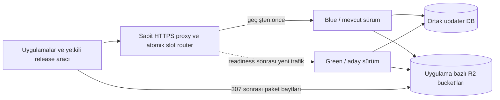

# Update Server İşletimi ve Blue/Green Dağıtım

Bu belge ortak update server'ın imaj üretimi, VPS kurulumu, kesintisiz sürüm geçişi ve geri dönüş sözleşmesidir. İstemci/manifest/release davranışı [ortak protokol belgesinde](./update-server.md) kalır. Karar: [DEC-C053](../baykuslig/kararlar/kapatilan-kararlar-c053.md). Dockerfile, Compose, CI ve deploy komutu [updates/deploy](../../updates/deploy/README.md) altında hazırlanmıştır; gerçekleşen kontroller [doğrulama kaydındadır](../planlama/dogrulama/update-altyapisi.md). Gerçek VPS/GHCR yayını henüz yapılmamıştır.

## Kaynak koddan çalışan server'a

`updates/services/update-server` çalıştırılabilir Rust paketidir. Test edilmiş release commit'i GitHub Actions'ta `Cargo.lock` korunarak, VPS'in Linux CPU mimarisi için derlenir. Docker build aşaması Rust araçlarını kullanır; runtime imajı server programı ve çalışma bağımlılıklarını taşır. VPS'te Rust derleyicisi veya kaynak repo bulunması gerekmez.

İmaj özel GitHub Container Registry'ye (GHCR) server sürüm etiketi ve kaynak commit bilgisiyle yayımlanır. Yayın etiketi başka içerikle overwrite edilmez; staging'de doğrulanan aynı imaj production'da digest ile sabitlenir. Production için ayrı build yapılmaz. `latest`/hareketli etiket üretim deploy hedefi olamaz.

İmaj üretimi CI'da otomatik, VPS deploy başlangıçta yetkili operatörün tek komutla başlattığı tekrarlanabilir akıştır. Yeni GitHub yayını veya client'in `cargo update` işlemi VPS'i otomatik değiştirmez. Komut `updates/deploy/deploy.sh deploy IMAGE@sha256:DIGEST` şeklindedir; bootstrap ve rollback aynı aracın ayrı modlarıdır. Komut backend, PostgreSQL veya proxy container'ını yeniden oluşturmaz.

GitHub Actions imaj yayınlama yetkisine, VPS yalnız gerekli özel imajı çekme yetkisine sahiptir. Uygulama paketlerini imzalayan private key ve R2 upload yetkisi server imajına/ortamına verilmez. Registry kimlik bilgileri, DB/R2 sırları ve proxy yönetim erişimi repo/imaj katmanında tutulmaz.

Server yazılımının sürümü, dağıtılan uygulama paketlerinin sürümlerinden ayrıdır. Server deploy veya rollback işlemi uygulama release'lerini yeniden publish/promote/disable etmez; katalog kendi veritabanında korunur.

## İlk VPS kurulumu ve topoloji

- Linux VPS'e Docker Engine ve Compose kurulur; staging/production sırları, ağları, DB/volume'ları ve R2 bucket eşlemeleri ayrılır.
- Updater'a ait PostgreSQL DB/rolü ve kalıcı volume/harici yedek hazırlanır. HTTPS proxy, domain/TLS ve GHCR okuma erişimi yapılandırılır.
- Compose'ta `update-server-blue` ve `update-server-green` aynı programın farklı imaj digest'leriyle çalışabilen iki slotudur. Slotlar aynı ortamdaki updater DB'sini ve uygulama bazlı R2 eşlemelerini kullanır; ikinci PostgreSQL/R2 kopyası açılmaz.
- Server slotlarına yalnız iç ağdan erişilir; dış trafik tek kararlı HTTPS adresinden proxy'ye gelir. Client ve Admin API yönlendirmeleri birlikte aktif slota taşınır; erişim politikaları geçişte değişmez.
- Normal durumda tek slot trafik alır. Deploy sırasında iki slot için CPU/RAM ve DB connection kapasitesi bulunmalıdır; gözlem sonrası eski slot kapatılabilir. Renkler sürüm veya ortam adı değildir, her başarılı deploy'da aktif rol değişir.

Proxy ürünü DEC-019'da seçilir; zorunlu özellikleri yapılandırma doğrulama, proxy prosesini durdurmadan upstream değiştirme, geçersiz değişiklikte mevcut yönlendirmeyi koruma ve devam eden istekleri drain etmedir. Yeni yapılandırma VPS yeniden başlatıldığında da aynı aktif slota dönmelidir. Hazır referans topoloji sabit Caddy TLS frontend ve HAProxy router kullanır; yalnız HAProxy runtime map'inin aktif değeri atomik değiştirilir. Caddy tam config reload'unun yerel sürekli trafik testinde erken bağlantı kapanması görülmüş; updater deploy geçişi frontend reload'undan çıkarılmıştır. Gerçek VPS'te mevcut TLS proxy ürününe göre bu router bağlanabilir.

## Deploy sırası

1. Ortam bazlı tek deploy kilidi alınır. Aktif proxy yönlendirmesi, slot, eski/yeni digest, config revizyonu, DB şema sürümü ve deploy kimliği kaydedilir. Hazırlık, gözlem ve drain zaman sınırları staging doğrulamasında seçilip deploy yapılandırmasına sabitlenir.
2. Aday digest indirilir; mevcut slot hizmet vermeye devam eder. Şema değişikliği varsa iki sürümle uyumlu migration ayrı tek seferlik migration göreviyle uygulanır. Başarısız indirme/migration trafik geçişini başlatamaz.
3. Pasif slot yeni imajla açılır. Liveness prosesin yaşadığını, readiness DB/şema, gerekli yapılandırma ve R2 erişimiyle istek sunabildiğini gösterir. Yalnız container'ın `running` olması hazır kabul edilmez.
4. Pasif slot doğrudan iç ağdan test edilir: iki uygulama için sürüm seçimi, yetkisiz özel kanal/Admin API reddi, Tauri yanıtı, lifecycle durumu ve test artifact'inin R2 yönlendirme/bütünlüğü. Bu kontroller gerçek yayını değiştirmez.
5. Proxy yeni isteklere hedef olarak adayı kullanacak biçimde doğrulanıp canlı yenilenir. Aday readiness veya proxy değişikliği başarısızsa aktif slot/yönlendirme korunur; eski slot durdurulmaz. Geçiş sonrasında dış HTTPS adresinden beklenen server sürümü ve temel akış doğrulanır.
6. Eski slot yeni istek almaz, devam eden istekler ve transaction'lar tamamlanır. DB/R2/cache politikası iki sürüm arasında tutarlı kalır; yeni sürümdeki hata/readiness kaybında sağlıklı eski slota geri yönlendirme yapılır. Gözlem süresi boyunca eski slot geri dönüş için hazır tutulur.
7. Gözlem ve drain tamamlandıysa eski slot graceful shutdown ile kapatılır. Drain zaman sınırı dolarsa aktif istekler zorla kesilmez; temizlik ertelenir ve operatöre sonuç bildirilir. Eski imaj/config geri dönüş kaydı korunur; veri volume'u silinmez.

Deploy adımları idempotenttir ve kalıcı aşama kaydı taşır. Komut/SSH bağlantısı yarıda kesilirse yeniden çalışma gerçek proxy hedefi, slot sağlığı ve digest'leriyle kayıt durumunu uzlaştırır. Hangi slotun aktif olduğu yalnız son log satırından çıkarılmaz. İki deploy aynı ortamda eşzamanlı trafik değiştiremez.

`docker compose pull` ve aday slot için `up --no-deps --wait` hazırlık adımlarıdır; Compose healthcheck readiness'i kullanır. Tek aktif servisi `compose up` ile yeniden oluşturmak, `--wait` kullanılsa da blue/green geçişi değildir. Toplu `compose down` bu deploy akışında kullanılmaz.

## Veri ve iki sürümün birlikte çalışması

- Migration ayrı kilitli görevde bir kez çalışır; iki slot başlangıçta eşzamanlı migration yapmaz. Runtime rolü normal servis işlemlerini, migration rolü şema değişikliklerini taşır.
- Şema önce geriye uyumlu genişletilir; uzun backfill küçük/idempotent işler olarak yürür. Eski alanların kaldırılması/anlamının değiştirilmesi eski slot ve geri dönüş penceresi kapandıktan sonraki ayrı yayındır. Trafiği bloke edecek lock gerektiren migration kesintisiz deploy kabulünü sağlayamaz; uygulanmadan yeniden tasarlanır.
- Eski sürüm yeni sürümün yazdığı lifecycle/politika kayıtlarını da okuyabilmelidir. Idempotency, transaction/DB kısıtları, cache invalidation ve varsa iş claim'leri iki instance çalışırken tekrar publish/yan etki veya stale revoke/rollout kararı üretemez.
- İstemci ve developer aracı protokol uyumluluğu server deploy'unda korunur. Yeni istemci/protokol gerektiğinde önce geriye uyumlu server desteği yayımlanır; desteklenen eski istemciler bir anda kesilmez.
- Server rollback proxy'yi önceki sağlıklı sürüme döndürür; DB otomatik downgrade/restore edilmez. Kullanıcıların bu sırada yaptığı release yönetimi ve yeni kayıtlar korunur. Uyumsuz şema varsa eski sürüme kör dönüş yapılamaz; ileri düzeltme veya ayrı doğrulanmış kurtarma planı gerekir.

## Kabul ve sınırlar

R2.S11 staging kapısı: deploy boyunca iki test uygulaması için mevcut sürüm kontrolü, Tauri yanıtı, durum sorgusu ve artifact indirme akışları sürekli çalıştırılır. Önce/sonra başarılı olduğu kadar trafik geçişi sırasında da beklenen status/içerik, uygulama/kanal ayrımı ve devam eden istekler doğrulanır. Deploy kaynaklı beklenmeyen hata/timeout ve kesilen istek sayısı `0` olmalıdır; invalid/unauthorized isteklerin beklenen hataları bu sayaca dahil edilmez.

Ayrıca hazır olmayan aday, image pull/migration/proxy hatası, geçiş sonrası readiness kaybı ve rollback, eşzamanlı Admin API retry, yarıda kesilen deploy komutunun yeniden çalışması, uzun süren isteğin drain'i ve VPS/proxy restart sonrası aktif slot/config tutarlılığı sınanır. Aday hata senaryolarında mevcut trafiğin sürdüğü kanıtlanır; readiness başarısı tek başına kesintisizlik kanıtı değildir.

Ölçüm yükü, gözlem/drain süreleri, eski-yeni digest/şema/config, trafik hata sayacı ve rollback sonucu deploy kanıtına yazılır. R6.S5 aynı akışı production imaj/config ile doğrular. Henüz bu testler çalıştırılmadı.

Bu sözleşme update server yazılım deploy'unda kesintisiz geçişi hedefler. VPS, ortak PostgreSQL/R2 veya proxy arızası/bakımı için yüksek erişilebilirlik garantisi vermez; backend'in blue/green dağıtımını da kendiliğinden kararlaştırmaz. Bu ihtiyaçlar ayrı kapasite/yedeklilik kararlarıdır.

Kaynaklar: [GHCR ve digest ile imaj çekme](https://docs.github.com/en/packages/working-with-a-github-packages-registry/working-with-the-container-registry), [Docker Compose up/health bekleme](https://docs.docker.com/reference/cli/docker/compose/up/), [HAProxy runtime map](https://www.haproxy.com/documentation/haproxy-runtime-api/reference/set-map/).
